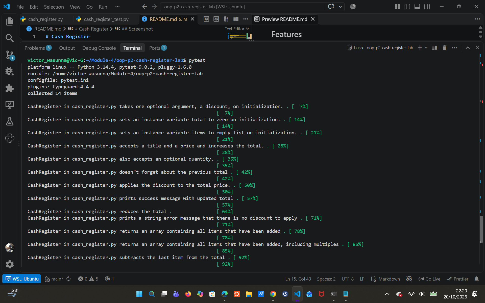

# Cash Register

A simple Python cash register model built with OOP.

## Features
- Add items with a price and quantity
- Apply a percentage discount to the total
- Void the last transaction

## How to run
    pip install pytest
    pytest

## Screenshot
